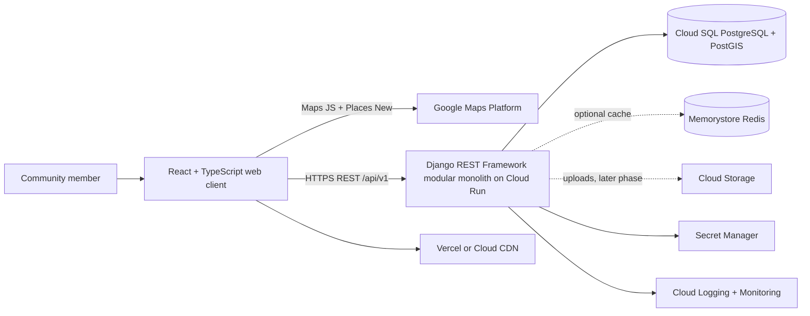
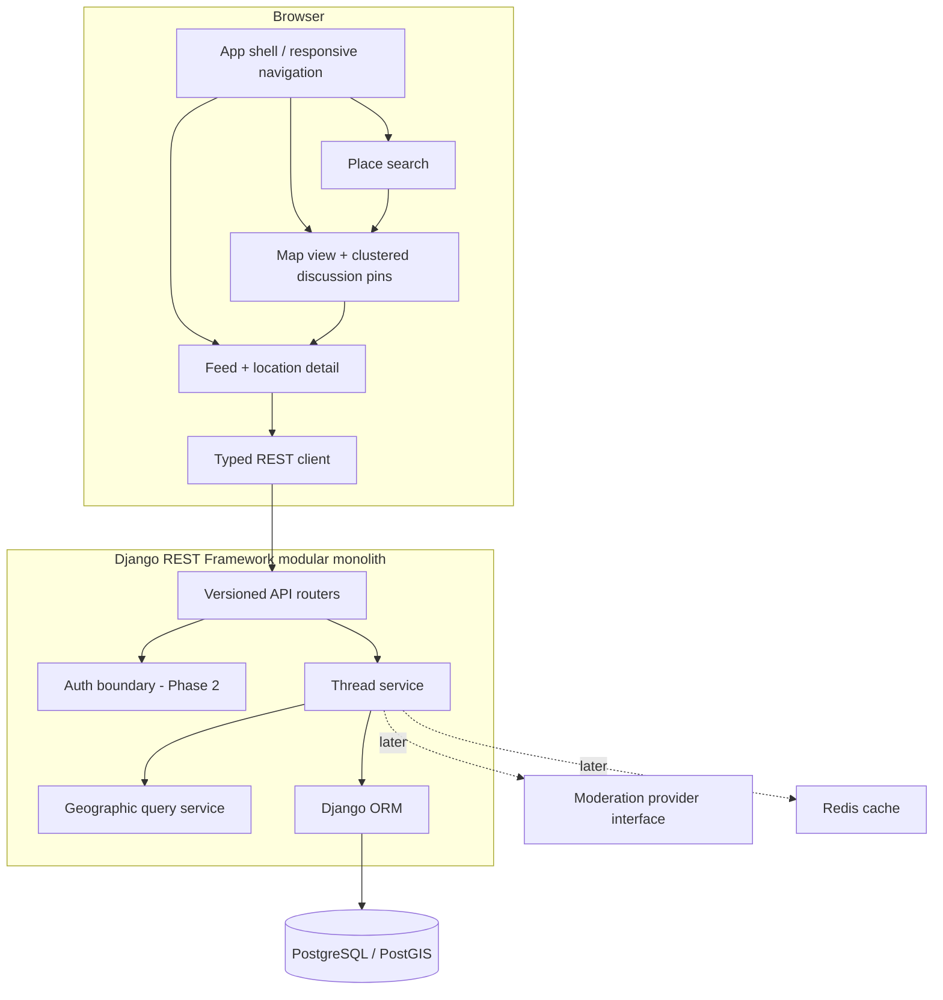
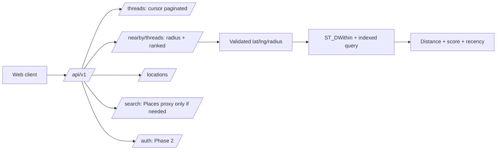
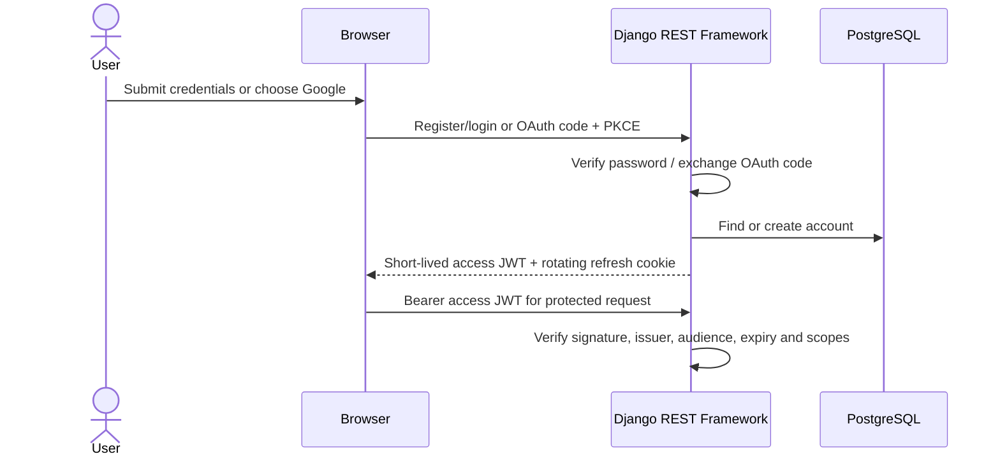
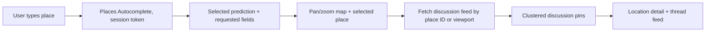
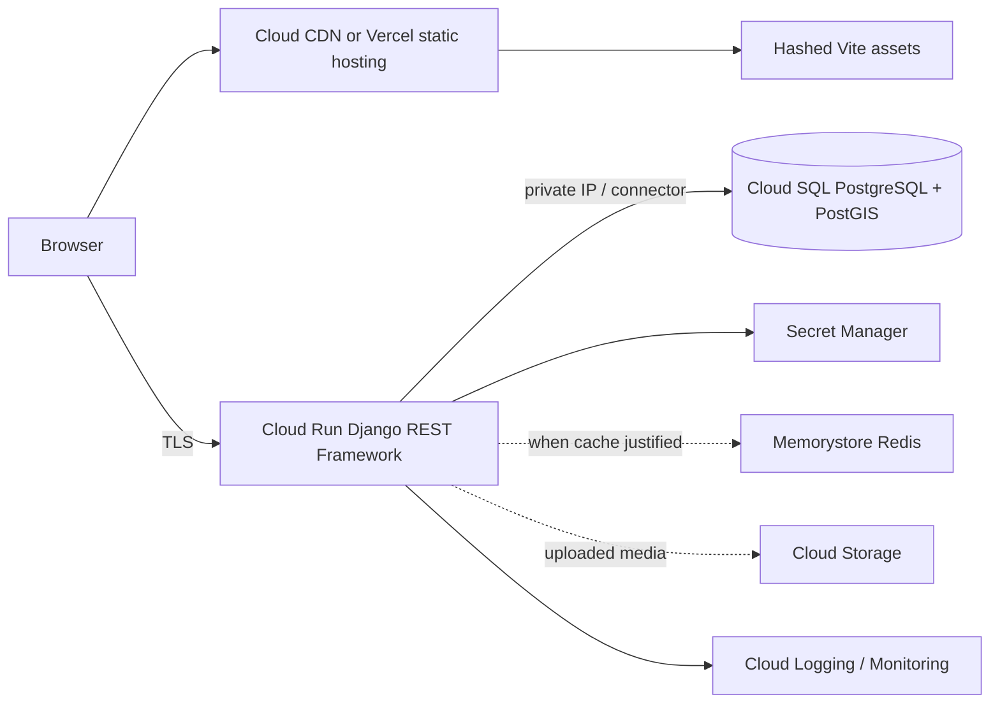

# System architecture

## 1. System context



## 2. Component architecture



## 3. Database ER diagram

```mermaid
erDiagram
  USERS ||--o| PROFILES : has
  USERS ||--o{ THREADS : authors
  LOCATIONS ||--o{ THREADS : contextualizes
  THREADS ||--o{ COMMENTS : contains
  USERS ||--o{ COMMENTS : authors
  USERS ||--o{ VOTES : casts
  THREADS ||--o{ VOTES : receives
  COMMENTS ||--o{ VOTES : receives
  USERS ||--o{ SAVED_THREADS : saves
  THREADS ||--o{ SAVED_THREADS : saved_as
  USERS ||--o{ LOCATION_FOLLOWERS : follows
  LOCATIONS ||--o{ LOCATION_FOLLOWERS : followed_by
  USERS ||--o{ REPORTS : submits
  THREADS ||--o{ REPORTS : reported
  USERS ||--o{ MEDIA : uploads
  USERS ||--o{ NOTIFICATIONS : receives
  USERS { uuid id PK string email UK string username UK }
  PROFILES { uuid user_id PK string avatar_url string bio }
  LOCATIONS { uuid id PK string google_place_id UK string name geometry boundary }
  THREADS { uuid id PK uuid author_id FK uuid location_id FK geography point position string title text body timestamp created_at }
  COMMENTS { uuid id PK uuid thread_id FK uuid parent_id FK uuid author_id FK text body }
  VOTES { uuid id PK uuid user_id FK uuid thread_id FK uuid comment_id FK smallint value }
  SAVED_THREADS { uuid user_id PK uuid thread_id PK }
  LOCATION_FOLLOWERS { uuid user_id PK uuid location_id PK }
  REPORTS { uuid id PK uuid reporter_id FK string target_type uuid target_id string reason }
  MEDIA { uuid id PK uuid owner_id FK string object_key string content_type }
  NOTIFICATIONS { uuid id PK uuid user_id FK string kind json payload timestamp created_at }
```

The initial migration-ready model focuses on `threads` and `locations`; the remaining entities are planned for Phase 2 onward. `geography(Point, 4326)` enables meter-based distance operations; GiST indexes support spatial filtering. Stable Google Place IDs are unique external identifiers, not substitutes for coordinates.

## 4. API architecture



Public MVP endpoints: `GET /api/v1/threads`, `GET /api/v1/nearby/threads`, `GET /api/v1/locations/{id}/threads`, `GET /health`. Thread creation and mutations require authenticated identity and arrive with Phase 2. Feed endpoints use bounded page sizes and opaque cursor pagination as the feed grows.

## 5. Authentication flow (Phase 2)



Use Argon2id for passwords; keep refresh tokens in secure, HttpOnly, SameSite cookies and protect cookie-authenticated mutations with CSRF defenses. OAuth secrets and signing keys belong in Secret Manager. Never place credentials in Vite variables except the restricted public Maps browser key.

## 6. Google Maps integration



Map movement updates local viewport state; fetch only after a deliberate idle/debounce and only when the viewport changes materially. Use Places field masks and autocomplete session tokens. The client uses a referrer/API-restricted browser key. A server key is unnecessary for this MVP; if server-side Places calls are introduced, isolate that credential in Secret Manager and restrict it by API and server identity.

## 7. Geographic search architecture

Requests validate finite WGS84 coordinates and clamp radius to a documented maximum. Django ORM binds values; PostGIS applies `ST_DWithin(position, origin, radius_meters)` against a GiST index. Distance is computed in meters and combined with upvotes, comment count, and recency for ranking. Place IDs and location IDs are exact indexed filters. City labels are descriptive metadata, never the geographic predicate.

## 8. Deployment architecture



Start as one modular monolith on Cloud Run. Cloud SQL is the durable relational store; Redis is optional until measured load needs it; Cloud Storage is introduced with media uploads; Secret Manager holds runtime secrets; Logging and Monitoring capture structured logs, latency, error rates, and database health. Pub/Sub and AI services remain future adapters, not MVP microservices.

## 9. Security architecture

- Validate all input with Django REST Framework serializers and ORM expressions.
- Set explicit CORS origins; enforce TLS in production and secure response headers.
- Apply rate limits at the edge/API for login, registration, posting and search before public launch.
- Hash passwords, authorize mutations at the service boundary, and scope admin actions explicitly.
- Validate upload MIME, extension, decoded format and size; store objects privately and serve short-lived signed URLs.
- Escape user content at render time; moderate/report content through replaceable service interfaces.
- Store production secrets in Secret Manager; use separate restricted browser/server Google credentials.
- Use CSRF tokens for cookie-authenticated writes; bearer-only APIs need a matching-origin policy where browser credentials are attached.

## Phase-by-phase plan

1. **Foundation (implemented here):** responsive React shell, Maps loader and Places search hook, Django REST Framework service, PostGIS-ready models/query, local service configuration, architecture docs.
2. **Social core:** registration/login, profiles, thread CRUD, comments and nested replies, votes and saves, authorization, Django migrations.
3. **Geographic discovery:** indexed nearby feed, map markers/clustering, location feed/statistics, location search and cursor pagination.
4. **Operations:** Redis where measured useful, validated media uploads, notifications, moderation workflows, rate limiting and observability dashboards.
5. **AI adapters:** moderation, summaries, semantic search, recommendations and duplicate detection isolated behind provider interfaces.
6. **Production hardening:** Cloud Run/Cloud SQL deployment, secret rotation, load/abuse validation, backup and recovery drills, cost monitoring and security review.
